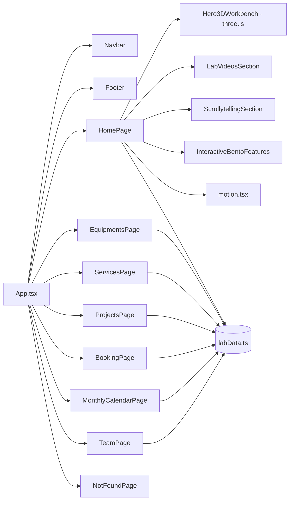

# Auditoria — Portal IF MAKER Marajó (makermarajo.com)

Data: 2026-11-04 · Modo: revisão inline (sem subagentes) · Escopo em `scope.json`

## Resumo

- SPA React 18 + Vite + Tailwind, 22 arquivos de código, sem backend nem API própria. Hospedado como site estático na Hostinger (deploy pelo GitHub).
- Mapa de dependências: `project-map.mmd` (arquivos) e `segments.mmd`. Tudo parte de `src/App.tsx` → páginas → componentes → `src/data/labData.ts` (fonte única de conteúdo).
- Segurança: sem vetores de XSS (`innerHTML`/`eval`), sem segredos no código, links externos com `noopener`. Faltavam cabeçalhos HTTP de segurança e havia 2 CVEs moderados no react-router — ambos corrigidos.
- Usabilidade: nenhum botão sem ação, nenhuma âncora quebrada. Rotas inexistentes mostravam a home (soft-404) — agora há página 404.
- Movimento: `framer-motion` estava instalado e sem uso; passou a dirigir parallax em camadas, abertura de seções ligada à rolagem e entradas em cascata, respeitando "reduzir movimento".
- Texto: cortes de ~50% na home e nos cabeçalhos das páginas internas; detalhes completos continuam nas páginas de cada equipamento.

## Mapa

## Correções aplicadas

| # | Área | Problema | Correção |
|---|------|----------|----------|
| 1 | Segurança | Servidor sem CSP real, X-Frame-Options, nosniff, Referrer-Policy, HSTS, Permissions-Policy | Cabeçalhos em `public/.htaccess`; CSP restrita a `self` + iframe do Google Agenda |
| 2 | Segurança | react-router 6.30 com 2 CVEs moderados (open redirect, SSR) | Atualizado para 7.18.5 — `npm audit`: 0 vulnerabilidades |
| 3 | Segurança/Perf. | Arquivos inexistentes (`*.js.map`) devolviam o HTML com 200 | Regra de rewrite só para caminhos sem extensão; cache longo para JS/CSS com hash |
| 4 | Usabilidade | Rotas inválidas abriam a home | `NotFoundPage` |
| 5 | Usabilidade | FAQ sem `aria-controls`/região | Acordeão acessível |
| 6 | Movimento | Página estática ao rolar | `src/components/motion.tsx`: `Parallax`, `SecaoViva`, `Cascata`, `TituloPalavras`, `MeandroVivo` |
| 7 | Movimento | Galeria + faixa infinita repetiam as mesmas fotos | Galeria única em 3 colunas com parallax em velocidades opostas |
| 8 | Texto | Parágrafos longos e listas repetidas | Home, vídeos, cards interativos, FAQ e cabeçalhos das páginas internas reduzidos |
| 9 | Ritmo | Scrollytelling com 460svh (rolagem longa) | 340svh |

## Pendências que dependem de vocês

- **Agenda incorporada** (`GOOGLE_CALENDAR_CONFIG.publicEmbedUrl` em `labData.ts`) mostra o calendário de **feriados nacionais**, não o do laboratório. Trocar pelo ID da agenda pública do lab.
- Números a confirmar: "+35 Kits" no topo (os dados somam 32) e "+45 sensores" no card de eletrônica.
- `three.js` deixa o JS principal com ~900 KB; carregar o hero 3D sob demanda reduziria o tempo de abertura no celular.
